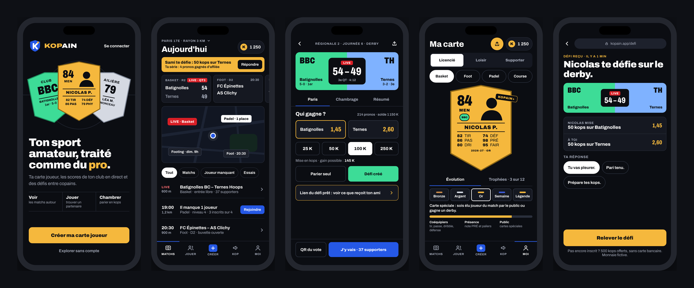
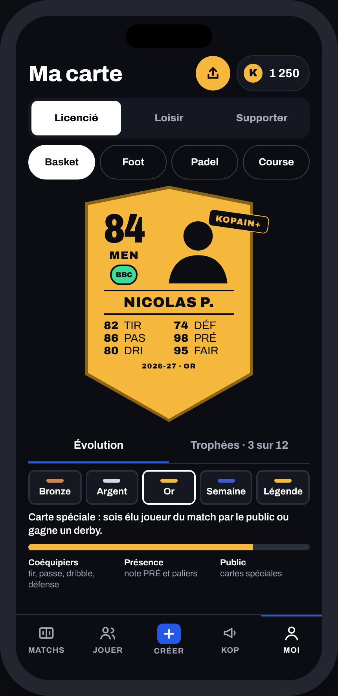
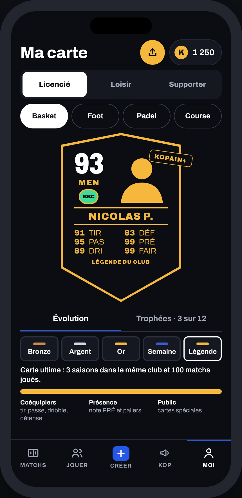
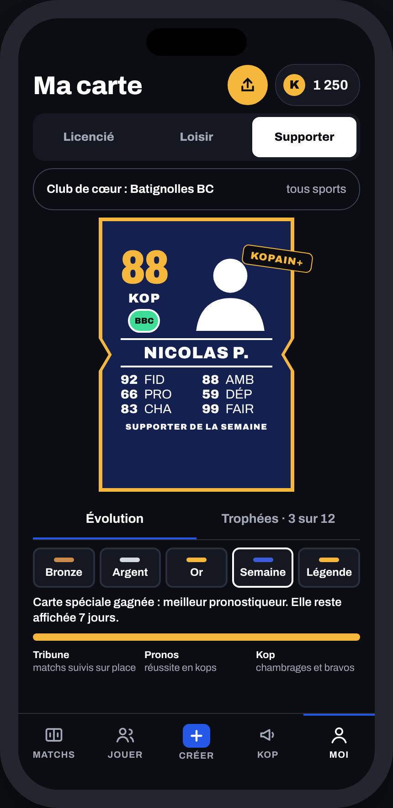
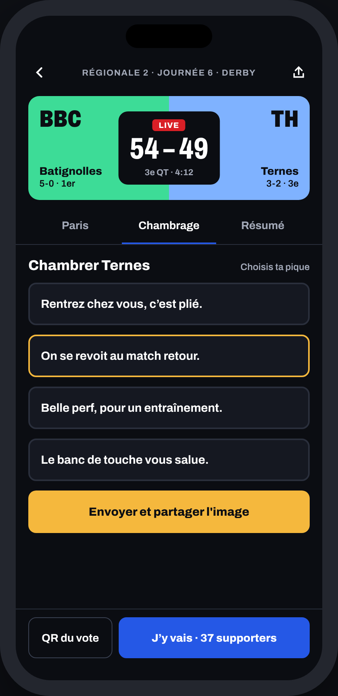

# Kopain

**Le sport amateur, traité comme du pro.** Concept d'application mobile qui rend visibles les matchs amateurs autour de soi, aide à trouver un partenaire ou le joueur qui manque, et fait vivre la rivalité entre clubs avec une carte joueur à collectionner et des paris en monnaie fictive.



**[Ouvrir le prototype interactif](https://VOTRE-PSEUDO.github.io/kopain/)** · **[Lire l'étude de cas complète](docs/etude-de-cas.md)**

---

## Le projet en une minute

| | |
| --- | --- |
| **Problème** | Le sport amateur est partout mais invisible : on ne sait pas qu'un match se joue à 600 m, on galère à trouver le quatrième au padel, et les clubs n'ont aucun moyen de faire venir du public. |
| **Solution** | Une carte vivante des matchs, tournois et parties autour de soi, une annonce « il manque un joueur » en trois gestes, et une couche de jeu (cartes, défis, chambrage) qui donne envie de revenir. |
| **Cibles** | Joueurs licenciés, pratiquants loisir sans licence, supporters, parents et clubs. |
| **Marché** | 17,4 millions de licences sportives en France en 2025, 850 000 pratiquants de padel. |
| **Modèle** | Gratuit pour tous ; abonnement Kopain+, offre Club Pro, commission sur les inscriptions, sponsoring local. |

## Ce que montre le prototype

14 écrans cliquables, à parcourir dans le navigateur.

| Écran | Ce qu'on y voit |
| --- | --- |
| Bienvenue et profils | Trois profils (licencié, loisir, supporter), chacun avec sa propre carte |
| Ajoute ton équipe | Un lien unique pour tout le vestiaire, bonus quand l'équipe est complète |
| Aujourd'hui | Défi en attente, scores en direct, carte des événements à proximité |
| Fiche match | Score par quart-temps, paris en kops, défi entre amis, chambrage prédéfini |
| Jouer | Joueur manquant et partenaires d'entraînement, avec taux de présence |
| Le Kop | Résultats, chambrages, classements des pronostiqueurs |
| Carte club | Carte du club à suivre, actualités, administration de la page |
| Ma carte | Carte évolutive du bronze aux cartes spéciales, selon le sport et le profil, trophées, tag Kopain+ |
| Partage | Story de résultat, de performance personnelle ou de chambrage |
| Défi reçu et vote | Les pages web vues par un ami ou un spectateur sans compte |
| Résumé du week-end | Le rendez-vous du dimanche soir |

<p>
  
  
  
  
</p>

## Choix de design

- **L'esthétique d'une appli de ligue pro, appliquée à l'amateur.** Fond sombre, tableaux de score, badges « LIVE », chiffres condensés : le joueur du dimanche est mis en scène comme un professionnel.
- **Les couleurs des clubs portent l'écran**, le doré est réservé au jeu (kops, cotes, défis, trophées) pour qu'on repère d'un coup d'œil ce qui est ludique.
- **Une action principale par écran**, toujours en bas, à portée de pouce. Parier se fait en deux gestes.
- **Une carte joueur à collectionner**, notée par les coéquipiers et qui évolue avec l'assiduité : c'est la raison de revenir chaque semaine.

## Pensé pour être viral

Chaque usage normal de l'app la montre à quelqu'un qui ne l'a pas encore :

1. **Défier un ami** sur un match : pour relever le défi, il faut ouvrir l'app.
2. **Chambrer** le club adverse avec une image partagée dans son groupe.
3. **Recevoir sa story** automatiquement à la fin du match.
4. **Voter** pour le joueur du match par QR code, sans compte.
5. **Inviter toute l'équipe** avec un seul lien.
6. **Partager son résumé** du week-end chaque dimanche.

## Méthode

Projet personnel mené par **Nicolas Pinaud** en pilotant **Claude (Anthropic)** de bout en bout.

- **Mon rôle** : définir la vision et les cibles, arbitrer chaque choix produit et design, orienter les itérations (passage d'un style ludique à une esthétique « sport pro », ajout des trois profils, de la carte évolutive, des paris et du chambrage).
- **Le rôle de l'IA** : recherche de marché sourcée, modèle économique et projections, maquettes, puis prototype web.
- **Le résultat** : d'une idée à un concept documenté et un prototype cliquable en quelques sessions de travail.

## Structure du dépôt

```
index.html            page de présentation (GitHub Pages)
app/                  prototype interactif, un fichier par écran
  kopain.js           moteur d'affichage des écrans
  kopain.css          mise en page et police
  fonts/              police Archivo (licence SIL OFL)
captures/             captures des écrans
docs/etude-de-cas.md  étude de marché, business model, plan de lancement
```

Le prototype fonctionne sans installation ni serveur : il suffit d'ouvrir `app/bienvenue.html` dans un navigateur.

## Mentions

Concept personnel, non affilié à une fédération ou à une marque. Clubs, joueurs et scores sont fictifs. Les « kops » sont une monnaie fictive : ni achat, ni gain d'argent. Les chiffres de marché proviennent des sources citées dans l'étude de cas ; les prix et projections sont des hypothèses de travail.
